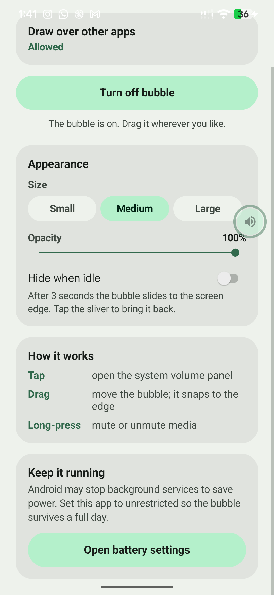
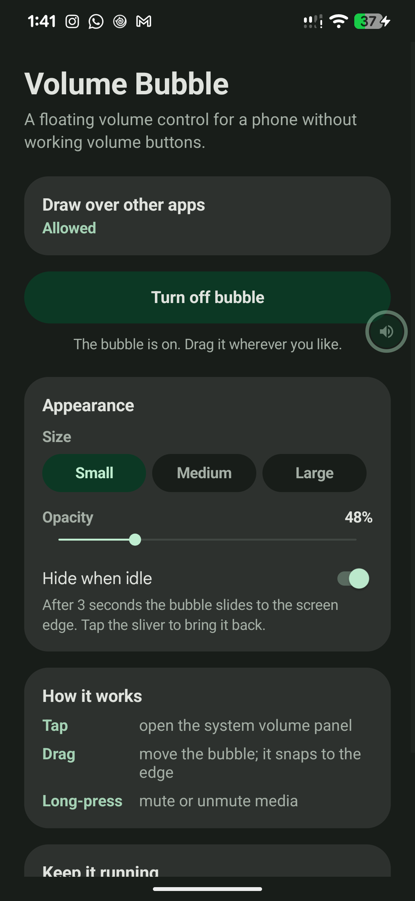

<div align="center">

# 🔊 Rockerless

### The volume rocker your phone forgot.

A floating volume bubble, a Quick Settings tile, and a system-matched look.
For phones whose physical volume buttons are broken, stuck, or simply gone.


&nbsp;&nbsp;

</div>

---

## Why Rockerless?

Your volume buttons broke. Android's built-in fixes are clumsy: the Accessibility Menu is a big grey panel, and Quick Tap needs a clean phone back. Rockerless gives you one small bubble that's always within reach. Tap it and you get Android's own volume panel. Long-press it and you mute.

No ads. No accounts. No internet permission. The whole app is about 1,100 lines of plain Kotlin, with no third-party libraries.

## Features

- **🫧 Floating bubble.** Drag it anywhere. It snaps to the nearest screen edge and remembers where you left it.
- **🎚️ Real system volume panel.** A tap opens Android's own volume UI, so it matches your phone, language, and Do Not Disturb rules.
- **🔇 One-press mute.** Long-press the bubble to mute media, long-press again to restore the previous level.
- **📊 Level ring.** A ring around the bubble shows the current media volume at a glance. The icon switches to a muted glyph at zero.
- **🎨 Follows your theme.** Light and dark mode, plus Material You dynamic colors from your wallpaper on Android 12 and later.
- **🙈 Stay out of the way.** Choose a small, medium, or large bubble and adjust its opacity. Turn on **Hide when idle** and the bubble slides into a sliver at the screen edge after 3 seconds. Tap the sliver to bring it back.
- **⚡ Quick Settings tile.** Open the notification shade and tap **Media volume** for the same panel, with a tile that shows mute state.
- **🔁 Survives reboots.** If the bubble was on, it comes back after a restart.

## How it works

| Gesture | Action |
| --- | --- |
| **Tap** the bubble | Opens the system volume panel |
| **Long-press** the bubble | Mutes or unmutes media |
| **Drag** the bubble | Moves it; it snaps to the nearest edge |
| **Tap** the sliver (auto-hide on) | Brings the bubble back |
| **Tap** the Quick Settings tile | Opens the system volume panel |

## Install

Rockerless isn't on the Play Store (yet). Build it from source and install the APK.

### Requirements

- Android **11 or newer** (API 30+). Tested on a Pixel 6 Pro running Android 17.
- JDK **17**.
- The Android SDK (command-line tools or Android Studio). `ANDROID_HOME` or `local.properties` must point to it.
- A USB cable and **USB debugging** enabled (or copy the APK to the phone and sideload it).

### Build and install

```sh
git clone https://github.com/Majidalee1/rockerless.git
cd rockerless

# Point Gradle at your SDK (skip if ANDROID_HOME is already set)
echo "sdk.dir=$HOME/Library/Android/sdk" > local.properties

./gradlew :app:assembleDebug
adb install -r app/build/outputs/apk/debug/app-debug.apk
```

The debug APK is at `app/build/outputs/apk/debug/app-debug.apk`.

## First-run setup

1. Open **Rockerless**.
2. Tap **Allow** next to *Draw over other apps* and turn it on. This lets the bubble float over other apps. It's the only permission that matters.
3. Allow notifications when prompted. Android requires a persistent notification for a floating control.
4. Tap **Turn on bubble**.
5. Optional: tap **Open battery settings** and set Rockerless to *Unrestricted*, so Android doesn't stop the bubble to save power.
6. Optional: add the **Media volume** tile to Quick Settings. Open Quick Settings, tap the pencil icon, and drag the tile into place.

## Settings

| Setting | Options | Default |
| --- | --- | --- |
| Size | Small (48 dp), Medium (56 dp), Large (64 dp) | Medium |
| Opacity | 30 % to 100 % | 100 % |
| Hide when idle | On / Off | Off |

Changes apply immediately to a running bubble.

## Permissions

| Permission | Why it's needed |
| --- | --- |
| `SYSTEM_ALERT_WINDOW` (*Draw over other apps*) | Shows the bubble above other apps. You grant this manually in Settings. |
| `MODIFY_AUDIO_SETTINGS` | Mutes and restores media volume, and opens the system volume panel. |
| `FOREGROUND_SERVICE` + `FOREGROUND_SERVICE_SPECIAL_USE` | Keeps the bubble alive while you use other apps. |
| `POST_NOTIFICATIONS` | Shows the required "bubble is on" notification, with a Stop button. |
| `RECEIVE_BOOT_COMPLETED` | Restores the bubble after a restart, but only if it was on. |
| `VIBRATE` | Haptic feedback on long-press. |

Rockerless does **not** use an accessibility service, does not read other apps' screens, and has **no internet permission**.

## Known limitations

- **Double-pressing the power button can't open the panel.** On Pixel phones, a double-press of the power button is reserved for the camera (or other system actions). Android doesn't let ordinary apps take that over, so use the bubble or the Quick Settings tile instead.
- **Quick Tap (back-of-phone tap) needs a case-free back.** Thick cases often block the tap detection.
- **The Quick Settings tile is tap-only.** Android doesn't send long-presses to tiles, so the tile opens the volume panel instead of muting.
- **Volume changes are polled.** Android doesn't broadcast media volume changes to apps, so the bubble checks the level about every 400 ms while it's on. The cost is negligible, but it's why the icon can lag a fraction of a second behind a hardware change.
- **Some OEM skins kill background services aggressively.** If the bubble disappears, set Rockerless to *Unrestricted* battery use.

## Project structure

```
app/src/main/java/app/volumebubble/
├── BubbleService.kt   # Foreground service: the floating bubble, drag/snap, auto-hide
├── BubbleView.kt      # Custom-drawn bubble: container, level ring, volume glyph
├── MainActivity.kt    # Setup and settings screen
├── MuteTile.kt        # Quick Settings tile
├── Volume.kt          # Mute/restore logic, system panel, level watcher
├── Palette.kt         # Light/dark and dynamic (Material You) colors
├── Prefs.kt           # All settings in one place
├── BootReceiver.kt    # Restores the bubble after reboot
└── Ui.kt              # Small view helpers
```

## Building from source

- Gradle 8.10.2 (wrapper included), Android Gradle Plugin 8.7.3, Kotlin 2.0.21.
- No third-party libraries. Everything is built on the Android framework, so the APK stays small.

```sh
./gradlew :app:assembleDebug   # build
./gradlew :app:lintDebug       # lint
```

## Contributing

Issues and pull requests are welcome. For larger changes, open an issue first so we can talk about the approach. Keep the no-dependencies, no-network stance in mind: it's a core part of the project.

## License

[MIT](LICENSE) © 2026 Majidalee1
